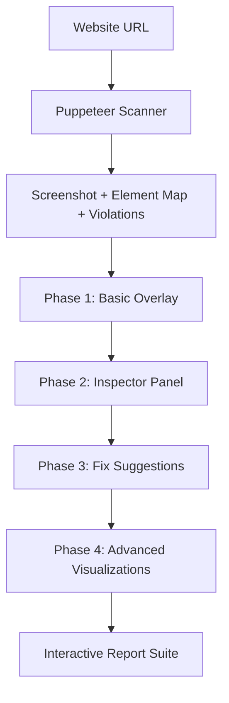

# Interactive Violation Report - Iterative Implementation Plan

## 🎯 Project Overview

**Goal:** Transform static accessibility reports into interactive, visual experiences that help developers understand and fix violations faster.

**Core Innovation:** Screenshot-based violation mapping with precise element highlighting and actionable fix suggestions.

---

## 📊 Input/Output Flow Analysis

### 🔄 **Data Pipeline Overview**



---

## 🏗️ Phase-by-Phase Implementation

### 📸 **Phase 1: Foundation - Screenshot + Basic Overlays**

#### **Input Data Structure:**
```json
{
  "url": "https://example.com",
  "violations": [
    {
      "id": "missing-alt-text",
      "selector": "img.hero-image",
      "impact": "serious",
      "wcagCriteria": ["1.1.1"],
      "message": "Image missing alt attribute"
    }
  ],
  "scanMetadata": {
    "timestamp": "2025-07-13T10:00:00Z",
    "scanDuration": 15000
  }
}
```

#### **Processing Steps:**
1. **Screenshot Capture:**
   ```javascript
   const screenshot = await page.screenshot({
     fullPage: true,
     type: 'png',
     quality: 85
   })
   ```

2. **Element Position Mapping:**
   ```javascript
   const elementMap = await page.evaluate(() => {
     return Array.from(document.querySelectorAll('*')).map(el => ({
       selector: generateSelector(el),
       bounds: el.getBoundingClientRect(),
       tagName: el.tagName,
       attributes: extractRelevantAttributes(el)
     }))
   })
   ```

3. **Violation-to-Position Mapping:**
   ```javascript
   const violationOverlays = violations.map(violation => ({
     ...violation,
     position: elementMap.find(el => el.selector === violation.selector)?.bounds,
     overlayStyle: generateOverlayStyle(violation.impact)
   }))
   ```

#### **Output Structure:**
```html
<!DOCTYPE html>
<html>
<head>
  <title>Accessibility Report - Interactive</title>
  <style>/* Overlay styles */</style>
</head>
<body>
  <div class="report-container">
    <div class="screenshot-container">
      
      <div class="violation-overlays">
        <!-- Dynamically generated overlays -->
      </div>
    </div>
    <div class="violation-summary">
      <!-- Basic stats -->
    </div>
  </div>
</body>
</html>
```

#### **Validation Criteria:**
- [ ] Screenshots captured for all test pages (40 test files)
- [ ] Overlay positions match actual elements (±5px tolerance)
- [ ] All impact levels visually distinguishable
- [ ] Report loads in <2 seconds
- [ ] Mobile responsive (breakpoints: 320px, 768px, 1024px)
- [ ] Zero JavaScript console errors
- [ ] Cross-browser compatibility (Chrome, Firefox, Safari, Edge)

#### **Test Data Sources:**
- `test-sites/bad-image-alt.html` (20+ violations)
- `test-sites/bad-form-labels.html` (56+ violations)
- `test-sites/good-accessibility.html` (0 violations)

---

### 🔍 **Phase 2: Violation Inspector Panel**

#### **Input Data Enhancement:**
```json
{
  "violations": [
    {
      "id": "missing-alt-text",
      "selector": "img.hero-image", 
      "htmlContext": "",
      "surroundingHTML": "<div class=\"hero\">...</div>",
      "wcagRule": {
        "id": "1.1.1",
        "title": "Non-text Content",
        "level": "A",
        "description": "All non-text content...",
        "successCriteria": "...",
        "helpUrl": "https://www.w3.org/WAI/WCAG21/Understanding/non-text-content.html"
      },
      "userImpact": {
        "description": "Screen reader users cannot understand the image content",
        "affectedUsers": "15% of users",
        "severity": "blocks navigation"
      }
    }
  ]
}
```

#### **Processing Components:**

1. **HTML Context Extraction:**
   ```javascript
   const extractHTMLContext = (selector, fullHTML) => {
     const element = document.querySelector(selector)
     return {
       target: element.outerHTML,
       parent: element.parentElement?.outerHTML,
       siblings: Array.from(element.parentElement?.children || []).map(el => el.outerHTML)
     }
   }
   ```

2. **WCAG Rule Mapping:**
   ```javascript
   const wcagDatabase = {
     "1.1.1": {
       title: "Non-text Content",
       level: "A", 
       techniques: ["H37", "H36", "H24"],
       examples: [/* ... */]
     }
   }
   ```

3. **Inspector Panel Generation:**
   ```javascript
   const generateInspectorPanel = (violation) => {
     return `
       <div class="inspector-panel" data-violation-id="${violation.id}">
         <div class="violation-header">
           <h3>${violation.wcagRule.title}</h3>
           <span class="impact-badge ${violation.impact}">${violation.impact}</span>
         </div>
         <div class="html-context">
           <pre><code class="language-html">${violation.htmlContext}</code></pre>
         </div>
         <div class="user-impact">
           <p>${violation.userImpact.description}</p>
         </div>
         <div class="wcag-reference">
           <a href="${violation.wcagRule.helpUrl}" target="_blank">Learn More</a>
         </div>
       </div>
     `
   }
   ```

#### **Output Enhancement:**
```html
<div class="report-layout">
  <div class="screenshot-panel">
    <!-- Phase 1 output -->
  </div>
  <div class="inspector-panel">
    <div class="panel-header">
      <h2>Violation Inspector</h2>
      <div class="controls">
        <select id="violation-filter">
          <option value="all">All Violations</option>
          <option value="critical">Critical Only</option>
        </select>
      </div>
    </div>
    <div class="panel-content">
      <!-- Dynamic content populated on click -->
    </div>
  </div>
</div>
```

#### **Validation Criteria:**
- [ ] Inspector panel shows correct HTML for each violation
- [ ] WCAG links are functional and accurate
- [ ] Panel adapts to different screen sizes
- [ ] Click interactions work without page refresh
- [ ] HTML syntax highlighting is accurate
- [ ] Performance remains <2s with 50+ violations

#### **Test Data Sources:**
- `test-sites/bad-form-labels.html` (multiple violation types)
- `test-sites/bad-keyboard-access.html` (complex interactions)

---

### 🛠️ **Phase 3: Interactive Fix System**

#### **Input Data Expansion:**
```json
{
  "violations": [
    {
      "id": "missing-alt-text",
      "fixSuggestion": {
        "type": "attribute-addition",
        "attribute": "alt",
        "suggestedValue": "Hero image showing product benefits",
        "confidence": 0.8,
        "alternativeValues": [
          "Main product showcase image",
          "Featured product illustration"
        ]
      },
      "fixComplexity": {
        "level": "easy",
        "estimatedTime": "2 minutes",
        "skillRequired": "basic HTML",
        "dependencies": []
      },
      "codeExample": {
        "before": "",
        "after": "",
        "explanation": "Add descriptive alt text that conveys the image's purpose"
      }
    }
  ]
}
```

#### **Processing Components:**

1. **Fix Suggestion Engine:**
   ```javascript
   const generateFixSuggestion = (violation) => {
     const fixTemplates = {
       'missing-alt-text': {
         type: 'attribute-addition',
         template: (context) => ({
           attribute: 'alt',
           value: generateAltText(context.imageSrc, context.surroundingText),
           confidence: calculateConfidence(context)
         })
       },
       'missing-label': {
         type: 'element-association',
         template: (context) => ({
           approach: 'label-element',
           implementation: generateLabelHTML(context.inputId, context.purpose)
         })
       }
     }
     
     return fixTemplates[violation.id]?.template(violation.context)
   }
   ```

2. **Difficulty Assessment:**
   ```javascript
   const assessFixComplexity = (violation, fixSuggestion) => {
     const complexityFactors = {
       attributeAddition: 'easy',
       elementReplacement: 'medium', 
       structuralChange: 'hard',
       multiFileChange: 'expert'
     }
     
     return {
       level: complexityFactors[fixSuggestion.type],
       timeEstimate: calculateTimeEstimate(fixSuggestion),
       dependencies: findDependencies(violation, fixSuggestion)
     }
   }
   ```

3. **Code Generation:**
   ```javascript
   const generateCodeExample = (violation, fixSuggestion) => {
     return {
       before: violation.htmlContext,
       after: applyFix(violation.htmlContext, fixSuggestion),
       diff: generateDiff(original, fixed),
       explanation: generateExplanation(fixSuggestion)
     }
   }
   ```

#### **Output Features:**
```html
<div class="fix-panel">
  <div class="fix-header">
    <h3>🔧 Suggested Fix</h3>
    <div class="complexity-badge easy">Easy Fix - 2 minutes</div>
  </div>
  
  <div class="code-comparison">
    <div class="before-after">
      <div class="code-block before">
        <h4>Before</h4>
        <pre><code class="language-html"><!-- Original code --></code></pre>
      </div>
      <div class="code-block after">
        <h4>After</h4>
        <pre><code class="language-html"><!-- Fixed code --></code></pre>
      </div>
    </div>
  </div>
  
  <div class="fix-actions">
    <button class="copy-code" data-code="fixed-html">📋 Copy Fix</button>
    <button class="mark-done" data-violation-id="">✅ Mark as Fixed</button>
    <button class="validate-fix">🔍 Validate Fix</button>
  </div>
  
  <div class="fix-explanation">
    <p>Add descriptive alt text that conveys the image's purpose to screen reader users.</p>
  </div>
</div>
```

#### **Validation Criteria:**
- [ ] Fix suggestions are syntactically correct HTML
- [ ] Copy-to-clipboard works in all browsers
- [ ] Time estimates are realistic (±25% accuracy)
- [ ] Code examples pass HTML validation
- [ ] Difficulty levels are consistent
- [ ] Performance remains acceptable with complex fixes

#### **Test Data Sources:**
- `test-sites/bad-keyboard-access.html` (complex fixes)
- `test-sites/bad-form-grouping.html` (structural changes)

---

### 📊 **Phase 4: Advanced Visualizations**

#### **Input Data Requirements:**
```json
{
  "siteAnalysis": {
    "violationDensity": {
      "regions": [
        {"selector": "header", "violationCount": 5, "severity": "high"},
        {"selector": "main", "violationCount": 12, "severity": "medium"}
      ]
    },
    "accessibilityTree": {
      "root": {
        "role": "main",
        "name": "Homepage",
        "children": [/* ... */]
      }
    },
    "tabOrder": [
      {"selector": "#nav-home", "tabIndex": 1, "issues": []},
      {"selector": "#search", "tabIndex": 2, "issues": ["missing-label"]}
    ],
    "colorAnalysis": {
      "contrastIssues": [
        {"foreground": "#666", "background": "#fff", "ratio": 3.2, "passes": false}
      ]
    }
  }
}
```

#### **Processing Components:**

1. **Heatmap Generation:**
   ```javascript
   const generateViolationHeatmap = (screenshot, violations, elementMap) => {
     const canvas = document.createElement('canvas')
     const ctx = canvas.getContext('2d')
     
     violations.forEach(violation => {
       const element = elementMap.find(el => el.selector === violation.selector)
       if (element?.bounds) {
         const intensity = getIntensityFromImpact(violation.impact)
         drawHeatmapPoint(ctx, element.bounds, intensity)
       }
     })
     
     return canvas.toDataURL()
   }
   ```

2. **Accessibility Tree Visualization:**
   ```javascript
   const renderAccessibilityTree = (tree) => {
     return `
       <div class="a11y-tree">
         ${renderTreeNode(tree.root)}
       </div>
     `
   }
   
   const renderTreeNode = (node) => {
     return `
       <div class="tree-node" data-role="${node.role}">
         <span class="node-label">${node.name || node.role}</span>
         ${node.children ? node.children.map(renderTreeNode).join('') : ''}
       </div>
     `
   }
   ```

3. **Advanced Filtering System:**
   ```javascript
   const createAdvancedFilters = (violations) => {
     return {
       byWCAG: groupBy(violations, 'wcagCriteria'),
       bySeverity: groupBy(violations, 'impact'),
       byElement: groupBy(violations, v => v.selector.split(' ')[0]),
       byFixComplexity: groupBy(violations, 'fixComplexity.level')
     }
   }
   ```

#### **Output Capabilities:**
```html
<div class="advanced-report">
  <div class="visualization-controls">
    <div class="view-modes">
      <button class="view-mode active" data-mode="overlay">🎯 Overlay View</button>
      <button class="view-mode" data-mode="heatmap">🔥 Heat Map</button>
      <button class="view-mode" data-mode="tree">🌳 A11Y Tree</button>
      <button class="view-mode" data-mode="flow">➡️ Tab Flow</button>
    </div>
    
    <div class="filters">
      <select id="wcag-filter">
        <option value="">All WCAG Levels</option>
        <option value="A">Level A</option>
        <option value="AA">Level AA</option>
      </select>
      
      <input type="search" id="violation-search" placeholder="Search violations...">
    </div>
  </div>
  
  <div class="visualization-area">
    <div id="overlay-view" class="view-panel active">
      <!-- Phase 1-3 content -->
    </div>
    
    <div id="heatmap-view" class="view-panel">
      <canvas id="heatmap-canvas"></canvas>
      <div class="heatmap-legend">
        <span class="legend-item critical">Critical</span>
        <span class="legend-item serious">Serious</span>
        <span class="legend-item moderate">Moderate</span>
      </div>
    </div>
    
    <div id="tree-view" class="view-panel">
      <div class="accessibility-tree">
        <!-- Generated tree structure -->
      </div>
    </div>
    
    <div id="flow-view" class="view-panel">
      <div class="tab-flow-visualization">
        <!-- Tab order visualization -->
      </div>
    </div>
  </div>
</div>
```

#### **Validation Criteria:**
- [ ] All visualization modes render correctly
- [ ] Filters work without breaking visualizations
- [ ] Heatmap accurately represents violation density
- [ ] Accessibility tree matches actual DOM structure
- [ ] Performance acceptable with 100+ violations
- [ ] Export features work (PNG, PDF, JSON)

#### **Test Data Sources:**
- Multi-page scan results from `reports/`
- Complex violation patterns from `test-sites/bad-complex-*.html`

---

## 🧪 Validation & Testing Strategy

### **Per-Phase Testing Protocol:**

#### 1. **Unit Testing:**
```bash
# Test core functionality in isolation
npm test -- --grep "Phase [1-4]"
```

#### 2. **Integration Testing:**
```bash
# Test with real scanner output
node test-sites/test-runner.js --validation-mode
```

#### 3. **Visual Regression Testing:**
```bash
# Compare screenshots of reports
node scripts/visual-regression-test.js --phase=1
```

#### 4. **Performance Testing:**
```bash
# Measure load times and memory usage
node scripts/performance-benchmark.js --scenarios=all
```

#### 5. **Cross-Browser Testing:**
```bash
# Manual testing checklist
echo "Testing in: Chrome, Firefox, Safari, Edge"
```

### **Log Analysis Checklist:**

```javascript
const validationChecks = [
  // JavaScript Errors
  "Zero uncaught exceptions",
  "Zero console.error() calls",
  "Zero network failures (404s)",
  
  // Performance Metrics
  "Page load time < 2 seconds",
  "Memory usage < 100MB",
  "Smooth 60fps animations",
  
  // Functionality Tests
  "All overlays positioned correctly",
  "All click handlers work",
  "All copy operations succeed",
  "All filters produce expected results",
  
  // Accessibility Tests
  "Report itself is accessible",
  "Keyboard navigation works",
  "Screen reader compatible"
]
```

### **Success Criteria Matrix:**

| Phase | Critical Requirements | Performance | Usability | Technical |
|-------|---------------------|-------------|-----------|-----------|
| 1 | Screenshots + overlays work | <2s load | Visual clarity | 0 JS errors |
| 2 | Inspector panel functional | <3s with 50 violations | Easy click-to-inspect | Responsive design |
| 3 | Fix suggestions accurate | Copy-paste works | Clear code examples | Syntax validation |
| 4 | All visualizations render | <5s with 100 violations | Intuitive filters | Export capabilities |

---

## 📁 File Structure

```
reports/
├── [scan-id]/
│   ├── index.html              # 📊 Main dashboard (Phase 1-4)
│   ├── data/
│   │   ├── violations.json     # Raw violation data
│   │   ├── elements.json       # Element position map
│   │   ├── screenshot.png      # Full page screenshot
│   │   └── metadata.json       # Scan information
│   ├── assets/
│   │   ├── styles.css          # Report styling
│   │   ├── scripts.js          # Interactive functionality
│   │   └── heatmap.png         # Generated heatmap (Phase 4)
│   └── exports/
│       ├── report.pdf          # PDF export
│       └── violations.csv      # CSV export
```

---

## 🚀 Implementation Timeline

### **Phase 1: Foundation (Week 1)**
- Days 1-2: Screenshot capture integration
- Days 3-4: Basic overlay system
- Days 5-6: Testing and validation
- Day 7: Documentation and review

### **Phase 2: Inspector (Week 2)**
- Days 1-2: Inspector panel UI
- Days 3-4: Click interaction system
- Days 5-6: HTML context extraction
- Day 7: Testing and refinement

### **Phase 3: Fix System (Week 3)**
- Days 1-2: Fix suggestion engine
- Days 3-4: Code generation and validation
- Days 5-6: Copy-paste functionality
- Day 7: User testing and feedback

### **Phase 4: Visualizations (Week 4)**
- Days 1-2: Heatmap and tree views
- Days 3-4: Advanced filtering system
- Days 5-6: Export capabilities
- Day 7: Final testing and polish

---

## 🔄 Continuous Validation

After each phase, run the complete validation suite:

1. ✅ **Functional Testing** - All features work as expected
2. ✅ **Performance Testing** - Meets speed requirements
3. ✅ **Visual Testing** - UI looks correct across devices
4. ✅ **User Testing** - Real users can complete tasks
5. ✅ **Code Review** - Code quality and maintainability
6. ✅ **Documentation** - Clear usage instructions

**Only proceed to next phase when all criteria are met.**

---

*Last Updated: 2025-07-13*
*Document Version: 1.0*